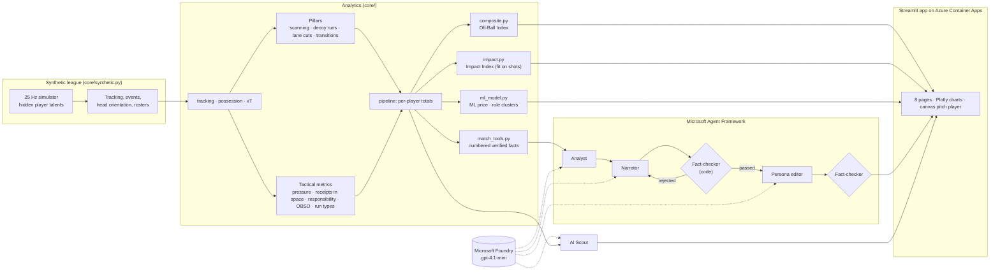

# Off-Ball Value

**Explainable match intelligence for the 90% of the game that happens without the ball.**

Event data records the pass, the shot and the tackle. It misses the run that dragged a centre-back away, the shoulder check before receiving and the sprint the moment the ball was lost. Off-Ball Value measures that work from 25 Hz tracking data and makes it explainable:
- it plays any moment back on a 2D pitch;
- it ranks and profiles every player against their own position;
- it prices players against their off-ball contribution;
- a team of AI agents writes match reports that are fact-checked against the data.

> **All data is synthetic.** The league, clubs, players, market values and matches are fictional, simulated by `core/synthetic.py` at 25 Hz with a head-orientation feed. The matches follow the laws of the game (fouls, yellow cards, free kicks, penalties, offside, corners, blocked shots, keepers diving and guessing a side at penalties) at Premier League rates, players keep their own space instead of overlapping, with about 64 minutes of the ball in play. No real match data, names or trademarks are used anywhere.

## What it does

| Page | What you get |
|---|---|
| **Tactical Playback** | Any moment of a match on a 2D pitch in the browser, under a scoreboard. Beside the pitch, highlight clips of the goals and each pillar (Scanning, Space, Pressing, Transition) play in one click; overlays show head-check cones, pitch control, xT and the lanes a press cuts. |
| **Match Leaderboards** | Every player in the match ranked, with the team battle, intensity by 15-minute block and a timeline of key moments. |
| **Match Report** | A report written by four agents and checked against the match facts. Every cited moment can be watched in the playback. |
| **Off-Ball Index** | Two 0–100 composite scores with rankings and radar polygons. The **Off-Ball Index** gives equal weight to ten metrics in five categories. The **Off-Ball Impact Index** weights the five tactical metrics by how much they move the team's shot balance. |
| **Player Profile** | One player against their position: index, polygon, pillar percentiles, match-by-match trend, a step-by-step breakdown of their ML price with the model's formula, and the most similar players. |
| **Value Finder** | Market value against off-ball work: a "Moneyball" quadrant and an out-of-fold ML price. |
| **AI Scout** | Plain-language questions about the league's off-ball work, answered from the same numbers. |
| **Model Check** | Whether the metrics recover the hidden talents the simulator gave each player. |

## Microsoft technology

- **Microsoft Foundry** hosts the model (`gpt-4.1-mini`) behind the Match Report agents and the AI Scout.
- **Microsoft Agent Framework** orchestrates the Match Report as a workflow graph:
  1. the **Analyst** reads the verified match facts through tools and picks the story;
  2. the **Narrator** writes it, citing every moment;
  3. the **Fact-checker** (code, not a model) rejects any time, number or player the facts don't support and sends the draft back;
  4. the **Persona editor** retells it for fans, analysts or broadcasters;
  5. the fact-checker checks the result again.
- **Azure Container Apps** runs the dashboard from the `Dockerfile`, scaling to zero when idle. GitHub Actions tests and builds the image, and model credentials are Container Apps secrets.

Without model credentials, the app still runs: the agents fall back to code-written, still-verified text.

## Architecture



## The metrics

**Four pillars**

| Pillar | Metric | Definition |
|---|---|---|
| Scanning | Scan rate | Quick head turns more than 60° off the ball in the 5 s before receiving |
| Space | Decoy run value | Extra xT-weighted pitch control teammates gain because the runner's markers followed them. Runs must end level with or ahead of the ball. |
| Pressing | Lane cuts | Threat-weighted share of the carrier's passing lanes inside the presser's cover shadow, projected 0.5 s ahead |
| Transition | Reaction score | How fast the player hits a sustained sprint after a turnover near the ball |

**Five tactical metrics:**
- Pressure Intensity
- Ball Receipts in Space
- Defensive Responsibility
- Off-Ball Scoring Opportunity (OBSO)
- Run types: in behind, pulling wide, dropping deep

Definitions are in [docs/off_ball_metrics.md](docs/off_ball_metrics.md). The two indexes are documented in [docs/composite_index.md](docs/composite_index.md) and [docs/impact_index.md](docs/impact_index.md).

### Do the metrics work?

The simulator gives every player hidden talents that the metrics never see. The Model Check compares each metric with the talent it should reflect (Spearman ρ, within position, 95% bootstrap intervals):

| Check | ρ |
|---|---|
| Scan rate vs awareness | 0.87 |
| Transition reaction vs work rate | 0.76 |
| Transition latency vs work rate | −0.66 |
| Lane cuts vs pressing | 0.54 |
| Decoy runs vs work rate | 0.27 (carried by forwards at 0.80; midfielders' decoy value doesn't yet track work rate) |
| Off-Ball Index vs combined off-ball talents | 0.54 |
| Pressures won vs pressing | 0.45 |

Receivers who made no head check kept the ball 75% of the time, against 83% with 3+ checks (7,636 receptions).

## Run it locally

```bash
python3 -m venv .venv && source .venv/bin/activate
pip install -r requirements.txt
python scripts/generate_synthetic_league.py      # 6 matches from seed 7 (~2 min, ~550 MB)
python scripts/precompute_scores.py              # optional: score once so every start is instant
streamlit run app.py                              # http://localhost:8501
```

For the AI features, copy `.env.example` to `.env` and fill in a Microsoft Foundry endpoint, key and deployment. `.env` is git-ignored.

Other commands:
- `pytest`: 155 tests.
- `python scripts/composite_index.py` and `python scripts/impact_index.py`: write the index rankings and radar data to `outputs/`.

## Deploy to Azure Container Apps

The dashboard runs on **Azure Container Apps**: the consumption plan, 2 vCPU / 4 GiB, scaling to zero when idle, with logs off. An occasional demo stays inside the monthly free allowance.

The image carries the synthetic league and its precomputed scores (`scripts/precompute_scores.py`), so a container that scaled to zero is ready in seconds instead of re-scoring every match. There are two ways to build it, and both follow the `Dockerfile`:

- **No Docker (what the live app uses).** `scripts/push_image.sh <registry> <tag>` assembles the image from `python:3.13-slim`, the Linux wheels and the app, and pushes it to Azure Container Registry with [crane](https://github.com/google/go-containerregistry). This route exists because Azure for Students subscriptions can't run ACR cloud builds.
- **GitHub Actions.** `.github/workflows/image.yml` tests, builds the `Dockerfile` and publishes to GitHub Container Registry on every push to `main`.

```bash
az login && az account set --subscription "Azure for Students"
az group create -n off-ball-value -l germanywestcentral
az acr create -g off-ball-value -n <registry> --sku Basic --admin-enabled true
python scripts/precompute_scores.py && scripts/push_image.sh <registry> v1
az containerapp env create -n off-ball-value-env -g off-ball-value -l norwayeast --logs-destination none
az containerapp create -n off-ball-value -g off-ball-value --environment off-ball-value-env \
    --image <registry>.azurecr.io/off-ball-value:v1 --registry-server <registry>.azurecr.io \
    --registry-username <user> --registry-password <password> \
    --ingress external --target-port 8501 --cpu 2 --memory 4Gi --min-replicas 0 --max-replicas 1 \
    --secrets foundry-key=<key> \
    --env-vars AZURE_OPENAI_ENDPOINT=<endpoint> AZURE_OPENAI_DEPLOYMENT=gpt-4.1-mini \
               AZURE_OPENAI_API_KEY=secretref:foundry-key
```

To ship an update, push a new tag, then run `az containerapp update -n off-ball-value -g off-ball-value --image <registry>.azurecr.io/off-ball-value:<tag>`.

## Project layout

```
app.py                  Streamlit dashboard (8 pages)
core/                   tracking, pillars/, pipeline, composite and impact indexes, ML, agents
ui/                     Plotly charts, playback payload, canvas pitch player
scripts/                league generator, index scripts
config/                 composite index weights (JSON)
docs/                   metric, index and impact-index method notes
tests/                  pytest suite
```

## Limitations

- The league has six matches. Players have at most about 280 minutes, so the rankings are indicative, not precise.
- The validation shows that the metrics recover what *this simulator* encodes. Real tracking data would need the thresholds rechecked and the impact weights refitted.
- The Impact Index is an association with shots, not cause and effect. Pressing and runs pay off indirectly, so their weights are probably understated.
