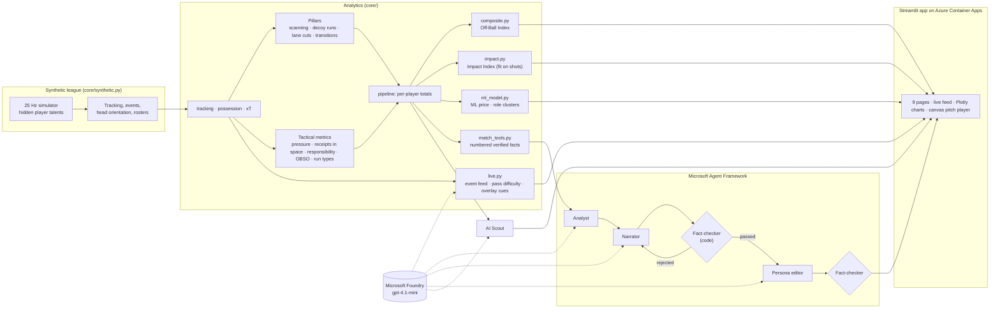

# Off-Ball Value

**Explainable match intelligence for the 90% of the game that happens without the ball.**

Event data records the pass, the shot and the tackle. It misses the run that dragged a centre-back away, the shoulder check before receiving and the sprint the moment the ball was lost. Off-Ball Value measures that work from 25 Hz tracking data and makes it explainable:
- it follows a match live, event by event, saying why each moment matters;
- it plays any moment back on a 2D pitch;
- it ranks and profiles every player against their own position;
- it prices players against their off-ball contribution;
- a team of AI agents writes match reports that are fact-checked against the data.

> **All data is synthetic.** The league, clubs, players, market values and matches are fictional, simulated by `core/synthetic.py` at 25 Hz with a head-orientation feed. The matches follow the laws of the game (fouls, yellow cards, free kicks, penalties, offside, corners, blocked shots, keepers diving and guessing a side at penalties) at Premier League rates, players keep their own space instead of overlapping, with about 64 minutes of the ball in play. No real match data, names or trademarks are used anywhere.

## What it does

| Page | What you get |
|---|---|
| **Live Match** | A match replayed as its events arrive. A running score and statistics (possession, shots, pass accuracy, pass difficulty), and commentary that says *why* each moment matters. A control-vs-chaos rhythm chart, and a downloadable **overlay feed**: every event as a timed, machine-readable cue for broadcast graphics. |
| **Tactical Playback** | Any moment of a match on a 2D pitch in the browser, under a scoreboard. Beside the pitch, highlight clips of the goals and each pillar (Scanning, Space, Pressing, Transition) play in one click; overlays show head-check cones, pitch control, xT and the lanes a press cuts. |
| **Match Leaderboards** | Every player in the match ranked, with the team battle, intensity by 15-minute block and a timeline of key moments. |
| **Match Report** | A report written by four agents and checked against the match facts. Every cited moment can be watched in the playback. Written for fans, analysts or broadcasters, in the reader's language and leading with their club or player. |
| **Off-Ball Index** | Two 0–100 composite scores with rankings and radar polygons. The **Off-Ball Index** gives equal weight to ten metrics in five categories. The **Off-Ball Impact Index** weights the five tactical metrics by how much they move the team's shot balance. |
| **Player Profile** | One player against their position: index, polygon, pillar percentiles, match-by-match trend, a step-by-step breakdown of their ML price with the model's formula, and the most similar players. |
| **Value Finder** | Market value against off-ball work: a "Moneyball" quadrant and an out-of-fold ML price. |
| **AI Scout** | Plain-language questions about the league's off-ball work, answered from the same numbers. |
| **Model Check** | Whether the metrics recover the hidden talents the simulator gave each player. |

### Made for every fan: "Your view"

The sidebar personalizes every page:

| Setting | What it does |
|---|---|
| **Mode** | **Fan** shows the key moments in plain words. **Analyst** shows every event with its numbers: shot speeds, pass accuracy and difficulty, fouls, offsides. |
| **Favourite club** | Stars that club's moments in the feeds. |
| **Follow a player** | Rings the player on the pitch, with their distance covered and their speed whenever they sprint (20 km/h or faster). Stars their moments, and opens the Player Profile on them. |
| **Language** | Commentary and match reports in English, Spanish, French, Portuguese, German, Italian, Arabic, Japanese or Chinese. Names, numbers and times stay exact, and translated reports pass the same fact-check. |

On the pitch, any ball moving faster than 70 km/h shows its speed: shots, and the hardest-hit passes.

**Pass difficulty** (0–100) uses only what is known when the ball is struck:
- how tight the lane is (60%);
- how pressed the passer is (20%);
- how far forward it goes (20%).

On held-out matches, under 3% of passes rated 0–30 fail, against 36% of those rated 60 or more.

## Microsoft technology

- **Microsoft Foundry** hosts the model (`gpt-4.1-mini`) behind the Match Report agents, the AI Scout and the multi-language live commentary.
- **Microsoft Agent Framework** orchestrates the Match Report as a workflow graph:
  1. the **Analyst** reads the verified match facts through tools and picks the story;
  2. the **Narrator** writes it, citing every moment;
  3. the **Fact-checker** (code, not a model) rejects any time, number or player the facts don't support and sends the draft back;
  4. the **Persona editor** retells it for fans, analysts or broadcasters, in the reader's language and leading with their club or player;
  5. the fact-checker checks the result again.
- **Azure Container Apps** runs the dashboard from the `Dockerfile`, scaling to zero when idle. GitHub Actions tests and builds the image, and model credentials are Container Apps secrets.

Without model credentials, the app still runs: the agents fall back to code-written, still-verified text.

## Architecture



## The metrics

Off-ball work is measured as four **pillars**:
- scanning;
- decoy runs;
- pressing lane cuts;
- transitions.

There are also seven **tactical metrics**:
- pressure intensity;
- pressures won;
- receipts in space;
- defensive responsibility;
- off-ball scoring opportunity (OBSO);
- run types;
- pitch control.

These combine into the Off-Ball Index. [How every number is calculated](#how-every-number-is-calculated) explains each one.

### Do the metrics work?

The simulator gives every player hidden talents that the metrics never see. The Model Check compares each metric with the talent it should reflect (Spearman ρ, within position, 95% bootstrap intervals):

| Check | ρ |
|---|---|
| Scan rate vs awareness | 0.87 |
| Transition reaction vs work rate | 0.76 |
| Transition latency vs work rate | −0.66 |
| Lane cuts vs pressing | 0.54 |
| Decoy runs vs work rate | 0.27 (carried by forwards at 0.80; midfielders' decoy value doesn't yet track work rate) |
| Off-Ball Index vs combined off-ball talents | 0.54 |
| Pressures won vs pressing | 0.45 |

Receivers who made no head check kept the ball 75% of the time, against 83% with 3+ checks (7,636 receptions).

## How every number is calculated

Every number comes from two inputs:
- **tracking:** where all 22 players and the ball are, 25 times a second, in metres;
- **the event log:** passes, shots, tackles, fouls, set pieces and so on.

All thresholds live in [`core/config.py`](core/config.py). Longer write-ups are in [docs/off_ball_metrics.md](docs/off_ball_metrics.md), [docs/composite_index.md](docs/composite_index.md) and [docs/impact_index.md](docs/impact_index.md).

### Building blocks

| Term | How it's calculated |
|---|---|
| **Possession** | The team of the most recent on-ball event (pass, shot, recovery, ball lost or set piece) owns the ball. It stays theirs until the ball goes dead: out of play, a foul, an offside or a goal. |
| **Expected threat (xT)** | How likely a spot on the pitch is to lead to a goal. It uses Karun Singh's model, learned from this league's own passes, carries and shots on a 16 × 12 grid. A zone's value is the chance of scoring from it directly, plus the value of where the ball usually goes next. |
| **Pitch control** | For any point, a logistic curve of (distance to the nearest defender − distance to the nearest attacker) ÷ 3 m. Whoever is clearly closer controls it, and control fades smoothly in between (a "soft Voronoi"). |
| **Speed** | Frame-to-frame movement, smoothed over 0.3 s. Anything faster than 43 km/h is treated as a tracking glitch. |

### Live Match

| Stat | How it's calculated |
|---|---|
| **Score, shots, on target** | Shot events up to the current minute. On target means scored or saved; a blocked shot doesn't count. |
| **Possession %** | Each team's share of the frames so far in which the ball was in play. Dead-ball time doesn't count for anyone. |
| **Passes, pass accuracy** | Every pass, including intercepted ones. Accuracy is the share that reached a teammate. |
| **Pass difficulty (0–100)** | 100 × (0.6 × lane + 0.2 × pressure + 0.2 × forward). It uses only what's known when the ball is struck. See below. The table shows the average over completed passes. |
| **Shot speed** | The ball's fastest frame-to-frame speed between the strike and where the shot ends, in km/h. |
| **Fouls, yellow cards, corners, offsides** | Counted from the event log. A foul is charged to the team that committed it. |
| **Game rhythm: control** (top bars) | For each 3-minute spell: the home team's share of the ball in play, minus 50%. Bars above the line are spells the home team controlled; bars below are the away team's. |
| **Game rhythm: chaos** (bottom bars) | For each spell: how many times possession switched teams, including through restarts such as throw-ins. Tall bars mean scrappy, end-to-end football. |
| **Commentary "why"** | Each line explains its own event: a goal's assist (pass length and difficulty) and the off-ball work in its build-up, the foul behind a card, or a key moment's measured detail. |
| **Overlay feed (JSON)** | The same feed, machine-readable. Each item has its time, clock, type, team, player, text, reason, and how long to show it: 8 s for key events, 5 s for detail. |

**Pass difficulty parts**, each from 0 to 1:
- **lane:** 1 − (gap between the pass's line and the nearest opponent) ÷ 5 m;
- **pressure:** 1 − (nearest opponent to the passer) ÷ 5 m;
- **forward:** how directly the pass heads for goal (1 = straight at goal, 0 = square or backwards).

It's validated on matches it wasn't tuned on. Failure rises steadily with difficulty: 0.5% of passes rated 0–15 fail, against 36% of those rated 60+. Length isn't used, because an intercepted pass's intended length is unknown.

### Tactical Playback

| Element | How it's calculated |
|---|---|
| **Followed player tags** | Distance covered since the clip began, plus their speed whenever they're at 20 km/h or faster (a sprint). |
| **Ball speed tag** | Shown whenever the ball moved faster than 70 km/h over the last frame: shots and the hardest-hit passes. |
| **Head-check cones** (yellow) | A head check is a quick turn of the head (at least 90°/s) to more than 60° away from the ball, lasting 0.1–2 s. |
| **Cover shadows and pink lanes** | The passing lanes from the ball carrier that a presser within 15 m blocks. See *Lane cuts*. |
| **Key moments / highlight clips** | Up to 8 of each kind per match, at least 15 s apart. See below. |

**What counts as a key moment:**
- **Decoy runs:** the runs that created the most xT.
- **Presses:** spells keeping at least 50% of the threat-weighted lanes cut for at least 1 s.
- **Transitions:** sprints within 1.5 s of a turnover. Under 0.2 s doesn't count, because the player was already sprinting.
- **Scans:** receptions kept after at least 3 head checks.

### The four pillars (per player)

| Pillar | How it's calculated |
|---|---|
| **Scan rate** | Head checks per second in the 5 s before each completed pass the player receives. A reception is skipped if head data covers less than 60% of that window. |
| **Decoy run value** (xT per 90) | The space a run opens for teammates. See the rules below. |
| **Pressing lane cuts** (s per 90) | On every frame the player is within 15 m of the carrier, the share of the carrier's passing lanes that their "cover shadow" blocks. See below. Summed over time, per 90 minutes. |
| **Transition score** | e^(−latency ÷ 2 s) − 0.5 × (share of the next 10 s spent walking, under 7 km/h). Latency is the seconds from a turnover to a sprint of 20 km/h or faster held for 1 s. Only players within 30 m of the ball at the turnover are judged. **Transition latency** is the median over turnovers where the player did sprint. |

**Decoy run rules.** A run must:
- be at least 15 km/h, for 1 s or longer, over 8 m or more;
- be made while the team has the ball;
- end level with or ahead of the ball;
- start more than 3 s after the team won the ball (earlier ones count as transitions).

Its value is the extra xT-weighted pitch control teammates gain because the runner's markers followed. Markers are defenders who had the runner as their nearest attacker for at least 60% of the run and moved with them. The comparison is with those markers having stayed with their defensive block. A run is never scored below zero.

**Lane cuts.** The cover shadow is a cone from the carrier through the presser's position 0.5 s ahead. Each lane is weighted by the receiver's xT × how open that receiver is.

### Tactical metrics (per player, per 90 minutes unless stated)

| Metric | How it's calculated |
|---|---|
| **Pressure intensity** | Pressure spells are at least 0.4 s within 10 m of the ball carrier, closing faster than 5 km/h. Intensity adds up closing speed × (1 − distance ÷ 10 m) × time, so ground made up from close counts more. |
| **Pressures won** | A pressure is *won* if, within 3 s of it ending, the presser's team gets the ball: by a tackle, an interception, or the pressed team passing it out of play. A player is credited once per win; several teammates pressing the same carrier are each credited. **Press win rate** is the share of a player's pressures won. |
| **Receipts in space** | The share of completed receptions where the nearest opponent was at least 5 m away when the ball arrived. |
| **Defensive responsibility** (lower is better) | Each player's zone is their usual offset from the team's centre at that moment. Every opponent pass that gains xT is charged to the zones near where it ends, shared by distance (Gaussian, 8 m). |
| **OBSO** (off-ball scoring opportunity) | Every 0.2 s in possession, for each attacker off the ball: xT of their spot × tanh(distance to the nearest defender ÷ 6 m) × e^(−distance from the ball ÷ 25 m). It counts whether or not the pass came. |
| **Run types** | Each run, measured against the team's own movement, needs at least 4 m with one direction holding 60% of it. It's *in behind* if it heads for goal and ends within 2 m of the last defender or past him, *pulling wide* if it heads for the touchline, and *dropping deep* if it comes back towards the ball. These describe style, not quality. |
| **Pitch control %** | Sampled every second while the team has the ball: the share of the pitch (on a 2 m grid) that goes to that player. Each cell goes to its nearest attacker, weighted by the team's control of it. |

### Scores and models

| Score | How it's calculated |
|---|---|
| **Pillar score** | The mean percentile of the four pillars among the players shown. |
| **Off-Ball Index** (0–100, the headline) | Ten metrics in five categories: spacing, movement, creation, scanning and defence. Each metric becomes a percentile among players in the same position. It's pulled towards 50 on a small sample, by n ÷ (n + k), where n is the player's minutes, receptions or transitions. Each category is the mean of its metrics, and the index is the mean of the categories. Under 90 minutes, there's no index. In match views it's computed within that match. |
| **Off-Ball Impact** | The five tactical metrics, weighted by how much each moves the team's shot difference across 5-minute windows. The weights come from a non-negative regression, after taking out possession share. Players are scored like the Off-Ball Index. |
| **ML price** | ln(price) = c + Σ 0.03 × tree_t(x), over 300 small gradient-boosted trees. x is the five off-ball metrics and the player's position. Each player is priced by a model trained on the *other* four-fifths of the league. The Player Profile breaks each price down step by step. |
| **Role (ML cluster)** | K-means (k = 4) on the standardised off-ball metrics. Each cluster is named after the metric it leads on. |
| **Similar players** | Distance on the four pillars, z-scored within position. Similarity = 1 ÷ (1 + mean distance). |
| **Team battle** | Each club's share of the two clubs' combined total on each metric. Labels show the raw values. |
| **Intensity by period** | Each club's off-ball totals in every 15-minute block. |
| **Model Check** | Spearman rank correlation between each metric and the hidden talent it should reflect, comparing players only with their own position. The 95% interval comes from 1,000 bootstrap resamples. The verdict is strong at 0.5 or above, moderate at 0.3, weak at 0.1. |
| **Scanning effect** | The share of receptions where the team kept the ball, by the number of head checks in the 5 s before (0, 1, 2, 3+), with Wilson 95% intervals. |

## Run it locally

```bash
python3 -m venv .venv && source .venv/bin/activate
pip install -r requirements.txt
python scripts/generate_synthetic_league.py      # 6 matches from seed 7 (~2 min, ~550 MB)
python scripts/precompute_scores.py              # optional: score once so every start is instant
streamlit run app.py                              # http://localhost:8501
```

For the AI features, copy `.env.example` to `.env` and fill in a Microsoft Foundry endpoint, key and deployment. `.env` is git-ignored.

Other commands:
- `pytest`: 155 tests.
- `python scripts/composite_index.py` and `python scripts/impact_index.py`: write the index rankings and radar data to `outputs/`.

## Deploy to Azure Container Apps

The dashboard runs on **Azure Container Apps**: the consumption plan, 2 vCPU / 4 GiB, scaling to zero when idle, with logs off. An occasional demo stays inside the monthly free allowance.

The image carries the synthetic league and its precomputed scores (`scripts/precompute_scores.py`), so a container that scaled to zero is ready in seconds instead of re-scoring every match. There are two ways to build it, and both follow the `Dockerfile`:

- **No Docker (what the live app uses).** `scripts/push_image.sh <registry> <tag>` assembles the image from `python:3.13-slim`, the Linux wheels and the app, and pushes it to Azure Container Registry with [crane](https://github.com/google/go-containerregistry). This route exists because Azure for Students subscriptions can't run ACR cloud builds.
- **GitHub Actions.** `.github/workflows/image.yml` tests, builds the `Dockerfile` and publishes to GitHub Container Registry on every push to `main`.

```bash
az login && az account set --subscription "Azure for Students"
az group create -n off-ball-value -l germanywestcentral
az acr create -g off-ball-value -n <registry> --sku Basic --admin-enabled true
python scripts/precompute_scores.py && scripts/push_image.sh <registry> v1
az containerapp env create -n off-ball-value-env -g off-ball-value -l norwayeast --logs-destination none
az containerapp create -n off-ball-value -g off-ball-value --environment off-ball-value-env \
    --image <registry>.azurecr.io/off-ball-value:v1 --registry-server <registry>.azurecr.io \
    --registry-username <user> --registry-password <password> \
    --ingress external --target-port 8501 --cpu 2 --memory 4Gi --min-replicas 0 --max-replicas 1 \
    --secrets foundry-key=<key> \
    --env-vars AZURE_OPENAI_ENDPOINT=<endpoint> AZURE_OPENAI_DEPLOYMENT=gpt-4.1-mini \
               AZURE_OPENAI_API_KEY=secretref:foundry-key
```

To ship an update, push a new tag, then run `az containerapp update -n off-ball-value -g off-ball-value --image <registry>.azurecr.io/off-ball-value:<tag>`.

## Project layout

```
app.py                  Streamlit dashboard (9 pages)
core/                   tracking, pillars/, pipeline, composite and impact indexes, ML, agents
ui/                     Plotly charts, playback payload, canvas pitch player
scripts/                league generator, index scripts
config/                 composite index weights (JSON)
docs/                   metric, index and impact-index method notes
tests/                  pytest suite
```

## Limitations

- The league has six matches. Players have at most about 280 minutes, so the rankings are indicative, not precise.
- The validation shows that the metrics recover what *this simulator* encodes. Real tracking data would need the thresholds rechecked and the impact weights refitted.
- The Impact Index is an association with shots, not cause and effect. Pressing and runs pay off indirectly, so their weights are probably understated.
